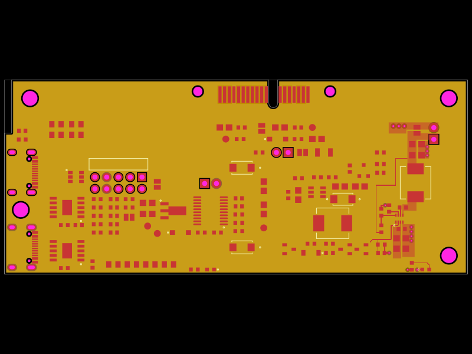
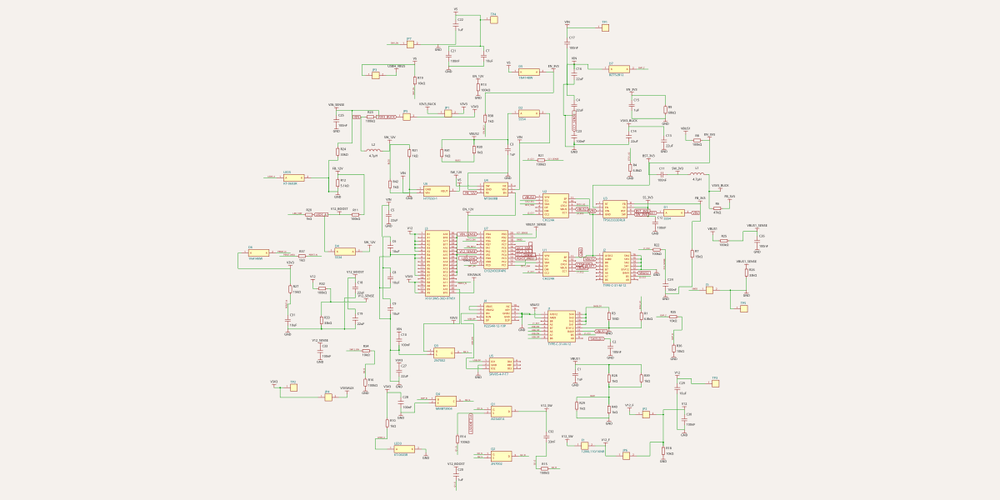
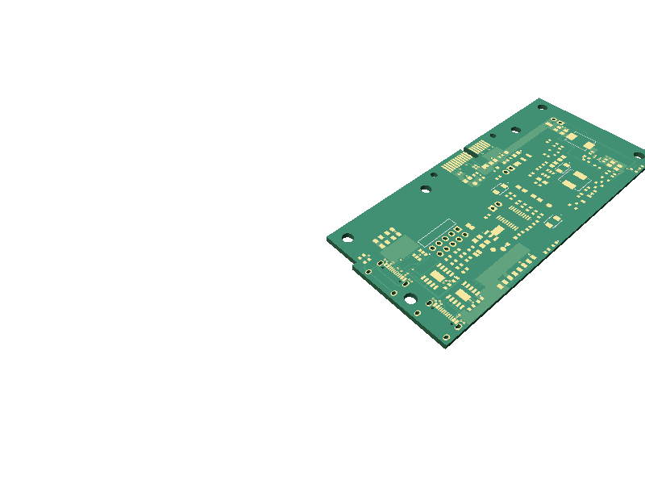
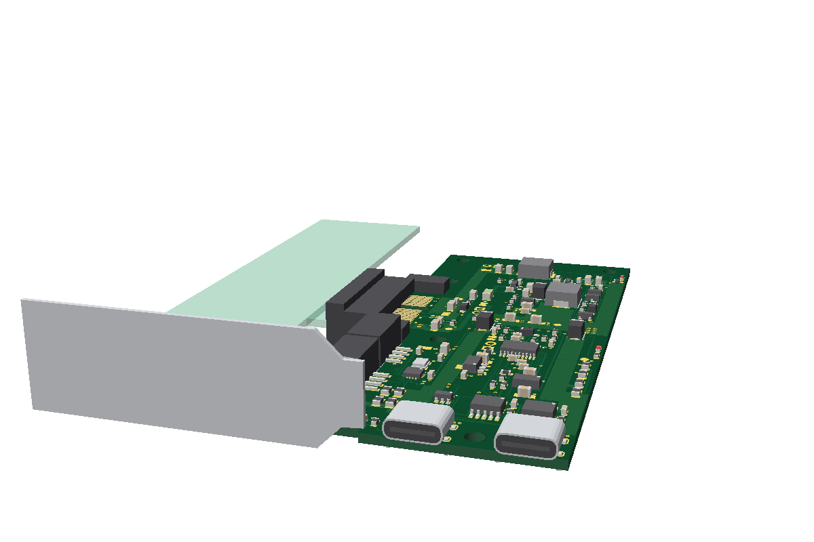
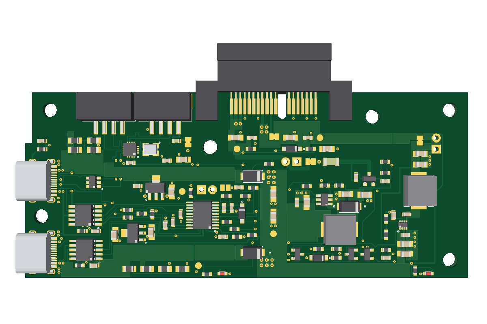

# outboard

An external board that powers a PCIe x1 TV tuner card from USB-C and connects it to a PC over the card's internal USB cable.
Status: pre-prototype. Nothing here has been built or tested on real hardware.
License: CERN-OHL-S-2.0.



## 何をする基板か

PLEX PX-MLT8PE のような PCIe x1 のチューナーカードは、PCIe からは電源 (3.3V と 12V) だけを取り、信号はカードの内部 USB ケーブルで出す。
outboard はその電源を USB-C (PD 9V) から作り、内部 USB を USB-C で PC へつなぐ。カードを PC の外に置ける。

- USB-C 2 口: J1 = PC へのデータ + 給電、J2 = 給電だけ
- カードの内部 USB の口 2 つ (機器 2 台) を、基板のハブ (CH334P) でまとめて J1 へ。カードとは JST PH 4 ピンのケーブル 2 本
- PCIe x1 のスロット J3 は基板の端をはさむ形 (straddle)。カードは基板と同じ平面に並ぶ (ケースを薄くするため)
- 回路と理由は [docs/design.md](docs/design.md)

## 状態

**rev D・試作前。実機では未検証。** KiCad + Python のスクリプトから [tscircuit](https://tscircuit.com) (TypeScript) へ作り直した (段階 5 の製造用の出力と文書の仕上げが残り)。

| 段階 | 中身                                                                   | 状態                                            |
| ---- | ---------------------------------------------------------------------- | ----------------------------------------------- |
| 0    | リポジトリの土台と CI/CD                                               | 済み                                            |
| 1    | フットプリント (データシートとの突き合わせ)                            | 済み ([docs/footprints.md](docs/footprints.md)) |
| 2    | 回路 (rev D のネットリスト + 変更の表と同じつながり方になることを検査) | 済み (食い違い 0)                               |
| 3    | 基板の検査 (自前)                                                      | 済み ([docs/checks.md](docs/checks.md))         |
| 4    | 配置と配線                                                             | 済み ([docs/routing.md](docs/routing.md))       |
| 5    | 製造用の出力と文書の仕上げ                                             |                                                 |

**回路は入った**: 部品 120 個・ネット 63 本・未接続のパッド 48 個が、rev D (KiCad) のネットリストに意図した変更の表 (`tools/netlist.ts`) を当てたものと完全に同じつながり方になっている (CI が毎回比べる)。
**USB のハブを足した**: カードは内部 USB の口を 2 つ持つ (機器 2 台) ので、2×5 のヘッダ J4 をやめ、ハブ U8 (CH334P) で 2 つに分けて、カードの口と同じ系統の JST PH 4 ピンの表面実装のコネクタ J4・J6 へ出す (市販の両端 PH ケーブル、同じ向き 1 → 1 でつなぐ)。カードの VBUS は専用の U9 (VBUS1 から)。基板は 100 × 42mm のまま。**J4・J6 のピンの割り当て (1 VBUS・2 D−・3 D+・4 GND) は元のケーブルの線の色からの推定で、確かめ待ち** (`lib/card-usb.ts` の 1 か所で変えられる。[design.md](docs/design.md#内部-usb-のコネクタ))。
**配線は完了。発注前の最終レビュー待ち。** 部品は `lib/placement.ts` に置き (ブロックごとの配置と、ブロックをまたぐネットの受け渡しの点。配置だけの絵は [`placement.circuit-pcb.snap.svg`](__snapshots__/placement.circuit-pcb.snap.svg))、銅は `lib/routing/` にブロックごとの別ファイルで書いてある ([docs/routing.md](docs/routing.md))。基板は 100 × 42mm ([docs/mechanical.md](docs/mechanical.md#寸法))・2 層。部品番号はうらのシルク (`lib/refdes.tsx`)。
**検査は全部 0** (CI とリリースが毎回): 自前の検査は `bun checks/run.ts --strict` で指摘 0・飛ばし 0、回路の値 0、rev D とのネットリストの食い違い 0、KiCad の DRC は `lib_footprint_issues` (書き出しの名前の都合) のほか 0。ブロックをつなぐ所は検査 `handoffs`、うらの GND は `groundPlane` が見る。
D1・D2 の放熱は、このまま試作して温度を測る (持ち主の判断)。5V の入力のときは、ファームウェアが最初から 3.3V の負荷を制限する。rev E の候補: 理想ダイオード (TPS2121 など) への置き換え (試作の結果しだい)。製造で確かめることと、余裕の小さい所は [docs/manufacturing.md](docs/manufacturing.md#見積もりの画面で見る所)。

KiCad の版は main から消した。タグ [`kicad-rev-c`](../../tree/kicad-rev-c) (rev C。検査 0) と
ブランチ [`rev-d`](../../tree/rev-d) (rev D の途中。回路図とライブラリまで) に残っている。

## 主な仕様

| 項目     | 値                                                                                                                      |
| -------- | ----------------------------------------------------------------------------------------------------------------------- |
| 入力     | USB-C ×2、USB PD 9V (CH224A ×2)。2 口を SS54 で合流                                                                     |
| 出力     | 3.3V・3A (TPS62933)、12V・0.5A (MT3608B)。12V は AO3401A + PTC で入り切り、過電圧で遮断                                 |
| マイコン | CH32V003 (電源の順序・監視・LED)                                                                                        |
| 基板     | 2 層・厚み 1.6mm (J3 のため)。100 × 42mm                                                                                |
| ケース   | 光造形 (JLC3DP の 9600)。外形 約 145 × 151 × 21mm (カードの寸法は推定。[docs/mechanical.md](docs/mechanical.md#ケース)) |

## 見方

- ブラウザで見る (main の最新。基板・回路図・3D): <https://danything.github.io/outboard/>
- 絵は [`__snapshots__/`](__snapshots__/) にある (回路図・おもてとうら・おもて・うら・3D)。PR では絵の差分として変化が見える
- 3D の絵は部品を載せた姿 (形は [`lib/cad.ts`](lib/cad.ts) がデータシートの寸法から作る簡単なもの)。カードとブラケットは推定の寸法で、半透明・途中で切って描く (発注のデータには入らない)。
  斜め上・真上・横・USB-C の側の 4 枚 (`tools/render3d.ts`)。Pages にも同じ絵がある (`index/3d.png`・`index/3d-top.png`・`index/3d-side.png`・`index/3d-usb.png`)

| 回路図                                                    | 3D                                             |
| --------------------------------------------------------- | ---------------------------------------------- |
|  |  |

| 3D (USB-C とブラケットの側)                              | 3D (真上)                                               |
| -------------------------------------------------------- | ------------------------------------------------------- |
|  |  |

## 作り方

道具はコンテナだけ (ホストに Bun も Node も入れない)。CI と同じイメージの中で動かす。中身は [compose.yml](compose.yml)。

```sh
docker compose up dev               # 起動。http://localhost:3020 に基板・回路図・3D (保存すると描き直す)
docker compose run --rm check       # 検査。CI の build と同じ一式 (下の script を全部)
docker compose run --rm snapshots   # 絵の更新 (__snapshots__ を描き直す)
docker compose run --rm kicad-drc   # KiCad の DRC。check に続けて KiCad の DRC と判定 (CI の全部)
```

- Zed で書くとき: コードは Zed、動く画面は横のブラウザで <http://localhost:3020> (main の最新でよければ [Pages](https://danything.github.io/outboard/))。
  絵だけ見るなら `__snapshots__/`。変えたら `snapshots` で描き直して、差分ごとコミットする
- wslc には compose が無い (3.0)。同じ中身を `run` で動かす。起動は下の 1 行。ほかは `-p` と `-e` を外し、`sh -c` の中身を compose.yml の `command` に替える
  (KiCad の DRC は `check` のあと、`--user 0 -w /work/dist/index/kicad kicad/kicad:10.0` で `kicad-cli`、続けて Bun で判定)。Git Bash では前に `MSYS_NO_PATHCONV=1` を付ける

```sh
wslc run --rm -it -p 127.0.0.1:3020:3020 -e CHOKIDAR_USEPOLLING=true -v .:/work -v outboard_node_modules:/work/node_modules -w /work oven/bun:1.4.4 sh -c "bun install --frozen-lockfile && bunx tsci dev"
```

script を 1 つずつ動かすときは、中に入る (`docker compose run --rm check bash`)。

```sh
bun run build      # dist/ に circuit.json・絵・KiCad の基板・見るためのページ
bun run check      # 型検査 (bun check)・テスト (bun test)・自前の検査 (基板・回路の値・rev D とのネットリストの比べ)
bun run snapshot   # __snapshots__ の絵と同じか。変えたときは bun run snapshot --update
bun run fab        # dist/fab/ に製造用のファイル一式
bun run case       # dist/case/ にケース (皿・ふた・ハッチ) の STL と STEP、絵 (先に build)
bun run lint       # oxlint と bun fmt --check。直すときは bun run format
```

- 版は全部固定してある (tscircuit は 0.0.x が 1 日に何度も出る)。上げるのは Renovate
- ビルドは外の部品検索に問い合わせない (`--disable-parts-engine`)。設計を tscircuit.com に送らない
- `tsci dev` には切る指定が無く、部品の品番を外の部品検索に問い合わせることがある (tscircuit 0.0.3161 の `<board>` にも切る指定は無い)
- `typescript` は入れていない。型検査は `bun check`。`circuit-json` は circuit.json の型のために入れてある

| 場所                          | 中身                                                                                                                                                                                                                              |
| ----------------------------- | --------------------------------------------------------------------------------------------------------------------------------------------------------------------------------------------------------------------------------- |
| `index.circuit.tsx`           | 基板の全体                                                                                                                                                                                                                        |
| `lib/`                        | `blocks.tsx` (ブロックごとの回路)・`parts.tsx` (部品。ピンとネットを型で縛る)・`nets.ts` (ネットの一覧)・`footprints.ts` (ランド)・`placement.ts` (位置)・`routing/` (銅。ブロックごと)・`geometry.ts` (外形)・`revision.ts` (版) |
| `land-patterns.circuit.tsx`   | 全部のランドを並べた見本 (作る基板ではない)                                                                                                                                                                                       |
| `checks/`                     | circuit.json を読む自前の検査と、検査のテスト。`board.ts` (基板)・`design.ts` (分圧の値・定格など、回路の意図)                                                                                                                    |
| `case/`                       | ケース (replicad)。`card.ts` (カードの推定の寸法)・`layout.ts` (形)・`case.test.ts` (中身と重ならないか)                                                                                                                          |
| `tools/`                      | 製造用の出力・スナップショット・KiCad の DRC の判定・`netlist.ts` (rev D とのネットリストの比べ)                                                                                                                                  |
| `fixtures/rev-d-netlist.json` | rev D の KiCad のネットリスト (部品と、パッドごとのつながり)。比べる相手                                                                                                                                                          |

## CI/CD

| いつ                                                                | 何をする                                                                                                                                                               |
| ------------------------------------------------------------------- | ---------------------------------------------------------------------------------------------------------------------------------------------------------------------- |
| PR・main への push ([check.yml](.github/workflows/check.yml))       | lint → ビルド (tscircuit の検査を含む) → 型検査・テスト・自前の検査 (rev D とのネットリストの比べを含む) → スナップショット → 製造用の出力 → ケース → **KiCad の DRC** |
| main への push                                                      | 上に加えて、見るためのページを GitHub Pages に出す                                                                                                                     |
| タグ `rev-*` の push ([release.yml](.github/workflows/release.yml)) | 同じ手順で作った製造用のファイルを GitHub Release に添付                                                                                                               |

- **二重の検査**: tscircuit が書き出した KiCad の基板に、KiCad 10 の DRC (`--refill-zones`) をかける。
  つながっていない所・短絡・面を塗り直したあとの間隔を見る。自前の検査との役割の分け方は [docs/checks.md](docs/checks.md)。
  書き出しのせいで出る指摘は、理由を付けて [tools/kicad-drc.ts](tools/kicad-drc.ts) で除外する。決まり ([tools/outboard.kicad_dru](tools/outboard.kicad_dru)) の数字は `checks/rules.ts` と同じ
- **成果物** (Actions の Artifacts): `fab` (ガーバーの zip・BOM・配置表・回路図の PDF・絵・circuit.json・SHA256SUMS)、`case` (ケースの STL・STEP・絵)、`site` (ページ)、`kicad-drc` (DRC の報告)
- **必須のチェック** (ルールセット `default`): `build / build`・`build / kicad-drc`・`claude-review`。緑になるまで main にマージできない。CI のジョブを足したり名前を変えたりしたら、ルールセットも直す: `gh api repos/danything/outboard/rulesets --jq '.[]|select(.name=="default").id'` で id を引き、`gh api -X PUT repos/danything/outboard/rulesets/<id> --input <直した JSON>`
- **スナップショット**: 絵が 1 つでも変わると CI が落ちる。Renovate の PR は、絵が変わらないときだけ自分でマージされる
- **リリース**: `lib/revision.ts` の版 (基板のシルクと同じ) と同じ名前のタグを main のコミットに打って push する。
  **発注するデータは必ずリリースから取る**。同じ版は出し直せないので、基板を変えたら版を上げる

## 文書

| ファイル                                       | 中身                                                               |
| ---------------------------------------------- | ------------------------------------------------------------------ |
| [docs/design.md](docs/design.md)               | ブロック図、ブロックごとの回路、つなぎ方ごとの動き、電力の見積もり |
| [docs/parts.md](docs/parts.md)                 | 部品と選んだ理由、LCSC の品番                                      |
| [docs/footprints.md](docs/footprints.md)       | ランドとデータシートの突き合わせの表、部品データの出どころ         |
| [docs/mechanical.md](docs/mechanical.md)       | 形の選び方、寸法、ブラケット、ケース、実物で測る所                 |
| [docs/firmware.md](docs/firmware.md)           | ファームウェアの仕様、LED の点滅                                   |
| [docs/manufacturing.md](docs/manufacturing.md) | JLCPCB への出し方、見積もり、ケースの JLC3DP への出し方            |
| [docs/bringup.md](docs/bringup.md)             | 試作で最初に測ること、試験の一覧                                   |
| [docs/history.md](docs/history.md)             | rev A〜C のレビューで決めたこと (いまの設計の理由)                 |
| [docs/checks.md](docs/checks.md)               | 基板の検査の一覧、自前の検査と KiCad の DRC の役割の分け方         |
| [docs/routing.md](docs/routing.md)             | 配線の書き方 (ファイルの分け方、層、座標、部品、確かめ方)          |

## ライセンス

[CERN-OHL-S-2.0](LICENSE)
