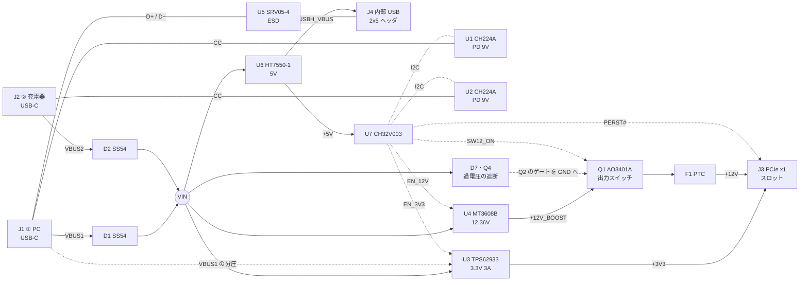

# 回路の設計

outboard の回路 (rev D) の全体の図、ブロックごとの回路と値の根拠、つなぎ方ごとの動き、電力の見積もりを書く。
**実機ではまだ何も確かめていない** (試作前)。ここの値はすべて計算かデータシートの読みである。

## ブロック図

- J1 (① PC) はデータと電源、J2 (② 充電器) は電源だけ。
- カードのデータは PCIe ではなく内部 USB を通る。スロット J3 へは電源と PERST# だけをつなぐ。
- マイコン U7 は CC・VIN・VBUS1・+12V を読み、3.3V と 12V を入り切りする。ピンの割り当ては [マイコンのピン](firmware.md#マイコンのピン)。

## つなぎ方ごとの動き

設計上の動き。試作で確かめる項目は [試験の一覧](bringup.md#試験の一覧)。

| つなぎ方                           | VIN                                           | 3.3V                                                       | 12V                                                                              | データ                                     |
| ---------------------------------- | --------------------------------------------- | ---------------------------------------------------------- | -------------------------------------------------------------------------------- | ------------------------------------------ |
| ① だけ。相手が PD で 9V を出す     | 9V (最大 9.5V) からダイオードのぶん下がった値 | 出る                                                       | 出る                                                                             | J1 から J4 へ通る                          |
| ① だけ。相手が 5V しか出さない     | 約 4.6V                                       | 電力が足りるとファームウェアが見てから出す                 | 出せるが、電流をファームウェアが抑える (値は試作で決める)                        | 通る。J4 の VBUS は 4.2〜4.4V になる見込み |
| ② だけ                             | ② の電圧からダイオードのぶん下がった値        | **出ない** (U3 の EN は VBUS1 の分圧だけで上がる)          | **出ない** (3.3V が無いと Q1 のゲートを引けない)                                 | なし                                       |
| ① と ② の両方                      | 2 つの入力をダイオードでまとめた値            | 出る                                                       | 出る                                                                             | 通る                                       |
| 12V 固定の AC アダプタ (PD でない) | 11.6〜12.3V                                   | VBUS1 があれば出る                                         | **保証しない** (過電圧の遮断の下のしきい値に触れる)                              | —                                          |
| 充電器の異常で 20V                 | 約 20V                                        | 部品は壊れない ([20V がかかったとき](#20v-がかかったとき)) | 止まっていれば入らない。出している最中は守れない ([過電圧の遮断](#過電圧の遮断)) | —                                          |
| マイコンが空・リセット中           | —                                             | ① があれば、VBUS1 の分圧だけで U3 が立つ (PD6 は Hi-Z)     | **出ない** (EN_12V と Q2 のゲートは抵抗で GND)                                   | 通る                                       |

ハードで保証していること (ファームウェアに頼らない):

- ② だけつないでも 3.3V は出ない
- 3.3V が無ければ 12V は出ない
- マイコンが空なら 12V は出ない
- VIN が約 13V を超えたら 12V は入らない (止まっている状態からの保護)

## ブロックごとの回路

### USB-C の入力と PD

- J1・J2 は 16 ピンの USB-C。U1 (J1 の側) と U2 (J2 の側) の CH224A が PD で 9V を要求する。取れなければ 5V。
- 電圧の設定は CFG1 と GND の間の 6.8kΩ (R1・R4。データシートの表 5-1 で 9V)。CFG1 にはほかに何もつながない。
- VHV (1 番) と VBUS (8 番) は、それぞれの VBUS へ。VHV に 1µF (C1・C3)。端子の側の VBUS のコンデンサは合計 10µF 以下にしてある。
- **CC は入れ替えてつないである**: 端子の CC1 (A5) を IC の 6 番 (CC2)、端子の CC2 (B5) を IC の 7 番 (CC1) へ。基板の上で 2 本を交差させないため。
  CH224A のデータシートは 2 本とも「Type-C CC 信号線」としていて、区別が出てくるのは使っていない eMarker の模擬だけなので、動作は同じと判断した (実機では未確認)。
- CC の線にはコンデンサをぶら下げない。J1 の CC は、直列 100kΩ (R21・R22) を通してマイコンの ADC でも読む (CC が 20V に触れても 0.15mA)。
- I2C は U1 と U2 で別の線 (I2C1_SCL/SDA と I2C2_SCL/SDA)。2 つの IC はアドレスを選べず同じなので、同じバスには置けない。
- DP/DM と PG は未接続。J2 の D+/D−/SBU と J1 の SBU も未接続。
- USB-C の殻は、1MΩ と 100nF の並列 (J1 の側は R3・C2) で GND へつなぐ。

### 入力のまとめとブリーダ

- VBUS1 → D1 → VIN、VBUS2 → D2 → VIN (どちらも SS54)。VIN から VBUS へ戻る道は、この 2 個の逆向きだけ。VBUS1 と VBUS2 をじかにつなぐ部品はない。
- ブリーダ: VBUS1・VBUS2 それぞれ、1kΩ 0805 (125mW) を 2 直列 × 2 並列 = 1kΩ で GND へ (VBUS1 は R28・R39 + R29・R40、VBUS2 は R30・R41 + R31・R42)。
  損失は 21V で 1 本 110mW、9.9V で 25mW。
- ブリーダの役目: ② だけに 9V が来ているとき、D1 の逆電流が VBUS1 に流れ込む。1kΩ なら 75℃ で 0.2V。
  0.8V (vSafe0V) に届くのは 0.8mA (SS54 のグラフでは 85〜90℃)、U3 の EN がオンになる 2.9V に届くのは 2.9mA (約 100℃)。
  **熱いときの余裕は、データシートの typical の線に対するもの**である。
- SS54 の値 (MDD、データシートから): 逆電流は最大 1.0mA (25℃)・50mA (100℃) (40V のとき)。9V のときはグラフ (typical) から 25℃ 約 4µA、75℃ 約 0.2mA、100℃ 約 3mA。
  順電圧は最大 0.55V (5A)、グラフ読みで 2A 約 0.36V・3A 約 0.42V。RθJA 60℃/W (5 × 5cm の銅)。接合温度は 125℃ まで。
- 熱は [電力の見積もり](#電力の見積もり)、SSL54 に替えなかった理由は [parts.md](parts.md#ss54-と-ssl54)。

### 3.3V の降圧

- U3 (TPS62933): 1 RT 未接続 (500kHz)、2 EN、3 VIN、4 GND、5 SW、6 BST、7 SS、8 FB。コイル L1 は 4.7µH。
- 出力 = 0.8V × (1 + 47k/15k) = **3.307V** (R6・R7)。出力のコンデンサは 22µF × 3 (公称の合計 66.1µF。データシートの実効の目安は 40µF、最小 15µF)。
- ソフトスタートは 100nF で 14.5ms (Css × 0.8V / 5.5µA)。BST-SW に 100nF。
- **EN は J1 の VBUS (VBUS1) の分圧だけで上がる** (R8 100kΩ / R9 68kΩ、比 0.405)。VIN や VBUS2 からの抵抗はない。これが「② だけでは 3.3V が出ない」の仕組み。
  - データシートのしきい値は、上がりが標準 1.21V・最大 1.28V、下がりが標準 1.17V・最小 1.10V。EN のピンの電流 (0.7µA、オンのあと +1.4µA) を入れて VBUS1 に直すと、
    **オンは標準 2.92V・最大 3.09V、オフは標準 2.68V・最小 2.51V**。
  - EN の電圧は、VBUS1 が 5V で 2.11V、9V で 3.73V、9.9V で 4.09V、12V で 4.94V (推奨の上限は 5.5V)。分圧だけで 5.5V に届くのは 13.6V、最大定格の 6V に届くのは 14.8V。
  - それより上は D5 (EN → +5V) が 5.7V 以下に抑える (20V のとき D5 に 0.14mA)。
  - C15 1µF で、VBUS1 が 5V になってからしきい値に届くまで 約 37ms (挿した直後のばたつきを避ける)。
- マイコンの PD6 は直列 1kΩ (R38) を通して EN につながる。PD6 が Low のとき EN は 0.05V (VBUS1 が 20V でも 0.20V)。
- 出力は L1 → +3V3_BUCK → JP5 (閉じたはんだジャンパー。JP1 のヘッダが並列) → +3V3。+3V3 → JP4 → +3V3AUX。LED3 は +3V3 でハードで光る。

### 12V の昇圧と出力スイッチ

- U4 (MT3608B): 1 SW、2 GND、3 FB、4 EN、5 VIN、6 NC。コイル L2 (4.7µH) は VIN と SW の間、D4 (SS34) は SW から +12V_BOOST。
- 出力 = 0.6V × (1 + 100k/5.1k) = **12.36V** (R11・R12)。
- EN (EN_12V) は R13 100kΩ で GND に落ちている。マイコンが空・リセット中は昇圧しない。
- **昇圧は止めていても、D4 を通って入力が出力へ素通しになる。** だから出力スイッチ Q1 が要る。
- Q1 (AO3401A、P-MOSFET): 1 G = Q1_G、2 S = +12V_BOOST、3 D = +12V_SW。ボディダイオードは出力から昇圧の側を向く。
- Q1 のゲートは R15 を通って Q2 → Q3 → GND へ引く (どちらも 2N7002 の直列)。
  - Q2 のゲートは SW12_ON (マイコンから R34 10kΩ を通る。ゲートは 100kΩ で GND へ)。マイコンが空なら 12V は出ない。
  - Q3 のゲートは +3V3。**3.3V が無ければ、Q1 のゲートを引く道が切れて 12V は出ない。**
- F1 (PTC、保持 1.1A・遮断 2.2A・16V): Q1 の出力 (+12V_SW) と +12V_F の間。+12V_F → JP6 (閉じたはんだジャンパー。JP2 のヘッダが並列) → +12V。
  F1 の抵抗は 0.04〜0.25Ω (データシート) で、0.5A のとき 0.02〜0.13V 下がる。
- +12V の線には GND への抵抗 (R18 10kΩ) がある (切ったあと 0V まで下げる)。
- 出力の短絡は、ハードでは速く切れない。扱いは [ファームウェアの仕様](firmware.md#仕様) の 5。

### Q1 のゲート

回路: Q1 のゲート-ソースに R14 100kΩ と C20 1µF、ドレイン-ゲートに C32 33nF、ゲートから R15 150kΩ を通って Q2・Q3 で GND へ。
下の値は回路シミュレーション (ngspice。AO3401A のモデルはデータシートの値から作ったもの) と計算で、実機の値ではない。

| 項目                                                      | 値                                                          |
| --------------------------------------------------------- | ----------------------------------------------------------- |
| 挿した瞬間の Vgs (9V の PD、VIN 8.6V)                     | −0.27V (4.6V のとき −0.15V)                                 |
| 同 (20V の異常、19.6V)                                    | −0.63V (Vth が最小 0.5V の個体は、出力に 2.5V 漏れる)       |
| オンのときの Vgs (昇圧の出力 12.36V / 13.8V)              | −4.94V / −5.52V (最大定格 ±12V)                             |
| 立ち上がり                                                | 1.8V/ms (14.7ms の遅れのあと)                               |
| 突入 (負荷のコンデンサ 100µF / 220µF、無負荷)             | 0.21A / 0.42A                                               |
| オフの遅れ (SW12_ON を下げてから出力が下がりはじめるまで) | 157ms (0.5V まで 207ms)。0.5A を流したまま切ると Q1 に 53mJ |

- 挿した瞬間は、C32 と C20 の分圧でゲートが取り残される (Vgs = VIN × C32 / (C32 + C20) = 8.6 × 33n / 1.033µ = 0.27V)。AO3401A の Vth の最小は 0.5V なので入らない。
- オンの Vgs −4.9V は、データシートの −4.5V の条件 (最大 60mΩ) より少し深い。0.5A で 30mV・15mW。
- **出力の短絡は、SW12_ON を下げても守れない** (切れるまで 50〜250ms、その間 Q1 に 1〜3J)。EN_12V を下げても、昇圧は D4 で素通しなので電流は止まらない。
- 次の版の候補: ゲートを速く放電する回路 (Q1 のゲート-ソースを小さな PNP か P-MOSFET で短絡する、または R14 を小さくして専用のドライバで引く)。rev D には入れていない。

### 過電圧の遮断

VIN が高いとき Q1 を入れると、昇圧の素通しでカードにその電圧がかかる。これをハードで止める。

- VIN → D7 (BZT52B12、12V ±2%、カソードが VIN) → R35 (10kΩ) → Q4 (MMBT3904) のベース。R36 (10kΩ) でベースを GND へ。Q4 のコレクタが Q2 のゲートを GND に引く。
- 効きはじめる VIN = Vz + 2 × Vbe → **12.2〜13.6V** (下の端は計算で 12.16V)。確実に切れるのは 13.8V 以上 (hFE 30 として)。
  9V の PD (VIN は最大 9.5V) では必ず入り、15V では必ず切れる (15V のときベース電流 0.14mA、要るのは 0.015mA)。
- **これは「止まっている状態」の保護である。** 12V を出している最中に VIN が 9V から 20V へ上がった場合、Q1 が切れるまで数十 ms 以上かかり
  ([Q1 のゲート](#q1-のゲート) の「オフの遅れ」)、その間はカードに高い電圧がかかる。防ぐのはファームウェアの役目 ([仕様](firmware.md#仕様) の 3)。
- **12V 固定の AC アダプタ (PD でない、VIN が 11.6〜12.3V) は、下のしきい値 (12.16V) に触れる。** その入力では 12V の出力は保証しない (入ったり入らなかったりする)。
- Q1 の Vgs は、切れる手前の 13.8V でも −5.5V。VIN が 20V (昇圧の出力に 19.5V が素通し) でも −7.8V で、±12V を超えない。
- ツェナーの数十 µA での電圧は、データシートの表に無く、見積もりである。しきい値は計算だけ。

### 5V とマイコン

- U6 (HT7550-1): 1 GND、2 VIN、3 VOUT = +5V。入力と出力に 10µF。+5V はマイコンの電源と、JP3 を通って J4 の VBUS (USBH_VBUS) になる。
- 5V 入力のときは +5V が 4.2〜4.4V になる見込み (マイコンの VDD も J4 の VBUS も)。
- U7 (CH32V003F4P6)。書き込みは J5 (1 = SWIO、2 = GND)。
- ADC: VIN・VBUS1・+12V は 100k/33k (0.248 倍) で読む。5V → 1.24V、9V → 2.23V、12.36V → 3.07V、20V → 4.96V。+12V はスロットの側 (JP2 の後ろ) を読む。
- PERST#: +3V3 へ R27 15kΩ、GND へ C31 10µF。τ = 150ms、2.0V まで 約 140ms (PCIe の T_PVPERL は 100ms 以上)。
  D6 が R27 に並列 (3.3V が落ちたらコンデンサをすぐ空にする)。マイコンの PC3 は直列 1kΩ (R37) を通り、PC3 が Low のとき PERST# は 0.21V (Low の上限 0.8V より下)。
- JP7 (開いたはんだジャンパー): SW1_IN と GND の間。SW1_IN は 10kΩ で +5V へ。つなぐと Low になり、ファームウェアが「12V を強制オン」と読む。
- LED5 (STAT) は PD0。点滅の意味は [LED の点滅](firmware.md#led-の点滅)。

### USB のデータ

- USB_DP: J1 の A6・B6 → U5 の 1 (IO1) → J4 の 5。USB_DN: J1 の A7・B7 → U5 の 3 (IO2) → J4 の 3。
- U5 (SRV05-4): 2 = GND。5 (REF) は未接続 (REF の TVS は 6V で、9V の VBUS にはつなげない)。4・6 (IO3・IO4) も未接続。
- J4 (内部 USB ヘッダ、2×5): 1・2 = USBH_VBUS、3 = D−、5 = D+、7・8 = GND。4・6・9・10 は未接続。

### PCIe スロット

J3 は 36 ピンの x1 スロット。1 番ピンの側に 11 ピン、キーの切り欠き、7 ピン。つなぐのは電源・GND・PERST# の 18 ピンだけ。

| ネット  | ピン                                                        |
| ------- | ----------------------------------------------------------- |
| +12V    | B1・B2・B3・A2・A3                                          |
| +3V3    | B8・A9・A10                                                 |
| +3V3AUX | B10                                                         |
| PERST#  | A11                                                         |
| GND     | B4・B7・B13・B16・B18・A4・A12・A15・A18                    |
| 未接続  | ほかの 17 ピン (PRSNT#・WAKE#・JTAG・SMBus・REFCLK・レーン) |

スロットの形と、どちらの列がどの面に来るかは [mechanical.md](mechanical.md#スロットと座標)。

### ジャンパーとテストポイント

| 部品             | つなぐ先          | 最初の状態 | 用途                           |
| ---------------- | ----------------- | ---------- | ------------------------------ |
| JP1 (1×2 ヘッダ) | +3V3_BUCK と +3V3 | 載せない   | 3.3V の電流を測る              |
| JP2 (1×2 ヘッダ) | +12V_F と +12V    | 載せない   | 12V の電流を測る               |
| JP3              | +5V と USBH_VBUS  | 閉じている | J4 の VBUS を切り離す          |
| JP4              | +3V3 と +3V3AUX   | 閉じている | 3.3V AUX を切り離す            |
| JP5              | +3V3_BUCK と +3V3 | 閉じている | JP1 に並列。測るときに橋を切る |
| JP6              | +12V_F と +12V    | 閉じている | JP2 に並列。測るときに橋を切る |
| JP7              | SW1_IN と GND     | 開いている | 12V を強制オン                 |

テストポイントは TP1〜TP5。使い方は [manufacturing.md](manufacturing.md#届いてから手ですること)。

## 20V がかかったとき

TVS は載せていない (JLCPCB の Basic に 20V 級が無い。Preferred の SMF24A は抑える電圧が 38.9V で、守りにならない)。
代わりに、20V (PD の上限は 21V) がかかっても壊れない部品でそろえた。

- VIN の側: U3 30V (最大定格 32V)、U4 24V (最大定格 26V)、U6 30V、コンデンサ 25V 以上、D1・D2 40V
- VBUS の側: CH224A の VHV・VBUS は 30V 級、CC は直列 100kΩ、ブリーダは 21V で 1 本 110mW (定格 125mW)、VBUS のコンデンサ 50V、
  U3 の EN は D5 が抑える、マイコンの ADC は 20V で 4.96V

20V を超える電圧と、挿した瞬間の跳ね上がりは、防いでいない。

## 電力の見積もり

出力は 3.3V・3A (U3) と 12V・0.5A (U4 + Q1 + F1)。

入力のダイオード (D1・D2) の損失 (計算):

| 入力              | ダイオードの電流 | 損失     | 温度の上がり (RθJA 60℃/W のとき) |
| ----------------- | ---------------- | -------- | -------------------------------- |
| 5V・3A (上限)     | 3A               | 1.26W    | 76℃                              |
| 5V でカードが 10W | 約 2.5A          | 約 1.0W  | 60℃                              |
| 9V・2A            | 2A               | 0.72W    | 43℃                              |
| 9V でカードが 10W | 約 1.35A         | 約 0.45W | 27℃                              |

- 60℃/W はデータシートの値 (5 × 5cm の銅に載せたとき) で、この基板の値ではない。rev D の基板での D1・D2 のまわりの銅の面積は**未定 (段階 4 で決める)**。
  守る下限は [history.md](history.md#基板で守ること)。
- 熱抵抗が 60〜90℃/W なら、5V・3A で 76〜113℃ の上がり (まわりが 40℃ なら接合 116〜153℃。定格は 125℃)。
  **5V で 3A を流し続けるのは危ない見込み**。9V では余裕がある。試作で温度を測る ([試験の一覧](bringup.md#試験の一覧))。
- 5V 入力では、12V の電流をファームウェアが抑える。値は試作で U4 の温度を測ってから決める。
- Q1 は 0.5A で 30mV・15mW。F1 での電圧の下がりは [12V の昇圧と出力スイッチ](#12v-の昇圧と出力スイッチ)。

## 基板の配線の数字

電源の線の幅と抵抗、USB の D+/D− の長さ、うらの面を通る線の長さは、rev D の基板がまだ無いので**未定 (段階 4 で決める)**。
基板で守る決まりは [history.md](history.md#基板で守ること)。

## コードの上のブロック

回路は `lib/blocks.tsx` に、ブロックごとの部品 (React のコンポーネント) として書いてある。配置と配線をブロックごとに進めるための境界は次のとおり。
ネットの名前は `lib/nets.ts` のもの (tscircuit の名前は `+` や数字で始められないので、+3V3 は `V3V3`、+12V は `V12`、PERST# は `PERST_N` と書く)。`GND` はどのブロックにもあるので省く。

| ブロック (`lib/blocks.tsx`) | 部品                                                                                                     | 入ってくるネット                                                   | 出ていくネット                                                     | ブロックの中だけのネット                                                                     |
| --------------------------- | -------------------------------------------------------------------------------------------------------- | ------------------------------------------------------------------ | ------------------------------------------------------------------ | -------------------------------------------------------------------------------------------- |
| `PdPortPc`                  | J1、U1、C1・C2、R1・R3、R28・R29・R39・R40、R21・R22、C23・C24                                           | `I2C1_SCL`・`I2C1_SDA` (マイコンと)                                | `VBUS1`、`USB_DP`・`USB_DN`、`CC1_SENSE`・`CC2_SENSE`              | `J1_CC1`・`J1_CC2`、`CFG1_U1`、`BLD1`、`SHIELD1`                                             |
| `PdPortCharger`             | J2、U2、C3、R4、R30・R31・R41・R42                                                                       | `I2C2_SCL`・`I2C2_SDA` (マイコンと)                                | `VBUS2`                                                            | `J2_CC1`・`J2_CC2`、`CFG1_U2`、`BLD2`                                                        |
| `InputMerge`                | D1・D2、C4〜C6、TP1                                                                                      | `VBUS1`、`VBUS2`                                                   | `VIN`                                                              |                                                                                              |
| `Buck3V3`                   | U3、L1、C8〜C15、C27・C28、R6〜R10、R38、D5、JP1・JP5、TP2、LED3                                         | `VIN`、`VBUS1` (EN の分圧)、`V5` (D5 の逃がし先)、`EN_MCU`         | `V3V3`                                                             | `SW_3V3`、`BST_3V3`、`SS_3V3`、`FB_3V3`、`EN_3V3`、`V3V3_BUCK`、`LED3_A`                     |
| `Boost12V`                  | U4、L2、D4、C16〜C19、R11〜R13                                                                           | `VIN`、`EN_12V`                                                    | `V12_BOOST`                                                        | `SW_12V`、`FB_12V`                                                                           |
| `Switch12V`                 | Q1〜Q4、F1、D7、R14〜R16、R18、R34〜R36、C20・C29・C30・C32、JP2・JP6、TP3                               | `V12_BOOST`、`VIN` (過電圧の検出)、`V3V3` (Q3 のゲート)、`SW12_ON` | `V12`                                                              | `Q1_G`、`Q2_G`・`Q2_D`・`Q2_S`、`OVP_Z`・`OVP_B`、`V12_SW`、`V12_F`                          |
| `Mcu`                       | U6、U7、C7・C21・C22、C25・C26・C31・C33、R19・R20、R23〜R27、R32・R33、R37、D6、J5、JP7、LED5、TP4・TP5 | `VIN`、`VBUS1`、`V12`、`V3V3`、`CC1_SENSE`・`CC2_SENSE`            | `V5`、`EN_MCU`、`EN_12V`、`SW12_ON`、`PERST_N`、`I2C1_*`・`I2C2_*` | `VIN_SENSE`、`VBUS1_SENSE`、`V12_SENSE`、`PERST_MCU`、`SW1_IN`、`SWIO`、`LED_STAT`、`LED5_A` |
| `UsbData`                   | J4、U5、JP3                                                                                              | `USB_DP`・`USB_DN`、`V5`                                           |                                                                    | `USBH_VBUS`                                                                                  |
| `Slot`                      | J3、JP4                                                                                                  | `V12`、`V3V3`、`PERST_N`                                           |                                                                    | `V3V3AUX`                                                                                    |

- 部品の種類 (品番・ランド・ピンの名前) は `lib/parts.tsx`。ブロックは「どのピンをどのネットへ」だけを書く。
- つながりは、基板のパッドから起こして rev D の KiCad のネットリスト (`fixtures/rev-d-netlist.json`) と比べている (`tools/netlist.ts`)。 rev D から意図して変えた所 (マイコンのピン 7 本) は同じファイルの `REV_D_CHANGES` に表で持ち、「rev D + その表 = いまの回路」を確かめる。ブロックの分け方を変えても、この比べが 0 のままなら回路は変わっていない。
- 部品の位置は、部品の名前で `lib/placement.ts` の表を引く (`positionOf("U3")`)。座標は基板の全体の座標。
