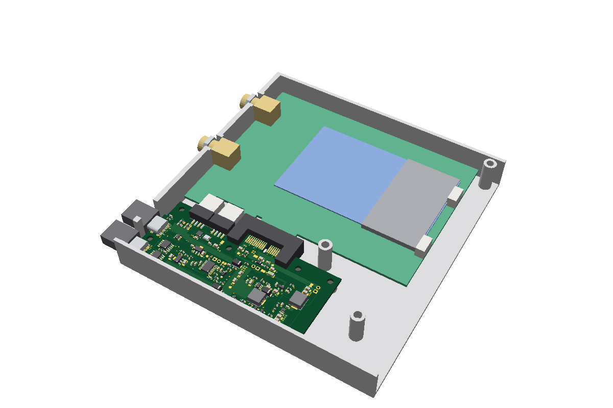
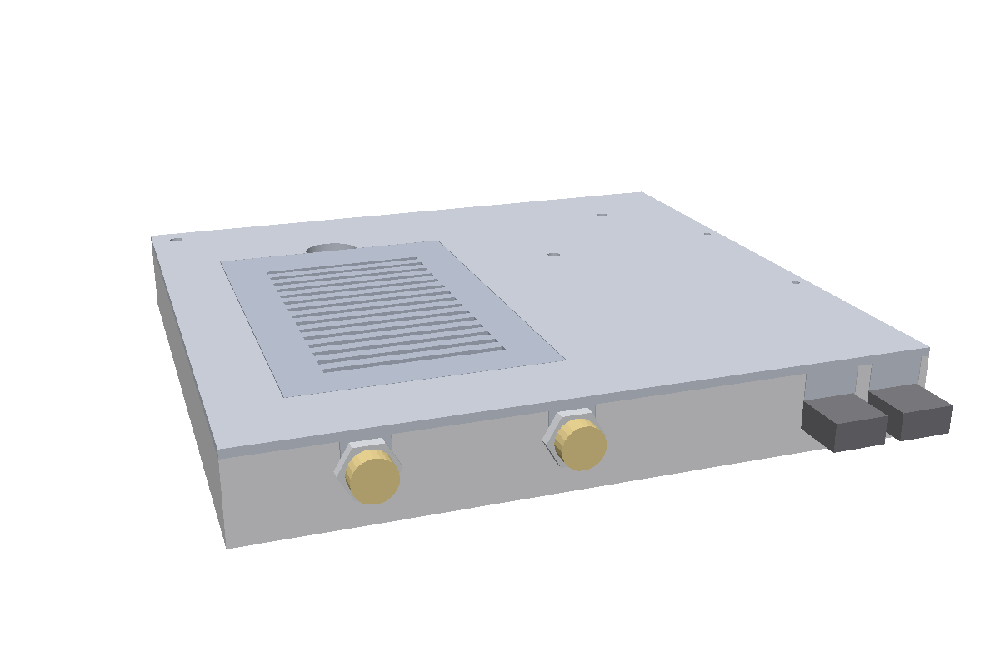
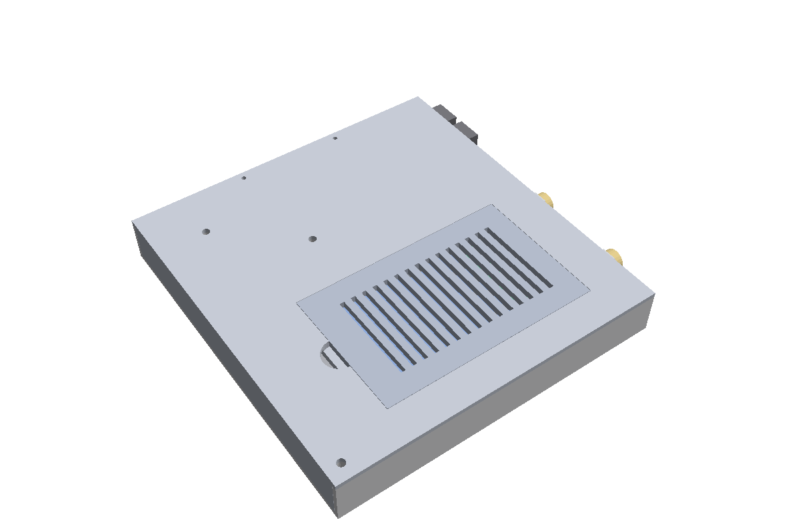

# 機構

outboard (rev D) の形の選び方、寸法、ブラケットとの関係、ケース、取り付け穴と、持ち主が実物で測る所を書く。
**ブラケットとカードの寸法は推定の値で、実物ではまだ測っていない。** 基板の外形 (100 × 42mm) と部品の位置は決めた (`lib/geometry.ts`・`lib/placement.ts`)。
ケースではカードのブラケットを外す。基板の寸法はブラケットの推定の位置から決めたもので、ケースの壁はそれに合わせる (基板は作り直さない)。

## 形の選び方

基板は 1 枚。スロット J3 を「基板の端をまたぐ」形 (straddle mount) にして、**カードと基板を同じ平面に並べる**。
持ち主の希望は、自分ではんだ付けしない・薄く・安く。

|                           | 2 枚・手はんだ              | 2 枚・コネクタの対                   | 1 枚・横向きスルーホール     | **1 枚・straddle (採った形)**               |
| ------------------------- | --------------------------- | ------------------------------------ | ---------------------------- | ------------------------------------------- |
| 自分でするはんだ付け      | スロット 36 ピン + つなぎ目 | なし                                 | なし                         | なし (JLCPCB が両面とも手はんだで付ける)    |
| ケースの内寸の厚み (推定) | 20.1 / 21.5                 | 20.1 / 21.5                          | 約 25.4                      | **20.1 / 21.6**                             |
| 基板の注文                | 2 件                        | 2 件                                 | 1 件                         | **1 件**                                    |
| 不安                      | 直角を出す、つなぎ目の強さ  | 厚みの中にコネクタの対が入るか未確認 | スロットの在庫が少ない。厚い | 手はんだの追加料金と治具の費用 (審査しだい) |

straddle を採った理由: 厚みが 2 枚の形と同じで、基板が 1 枚で済み、つなぎ目が無い。JLCPCB が J3 を載せられないと分かった場合でも、
自分で付けるのはスロット 1 個 (片面 18 パッド × 2) で、2 枚の形より少ない。横向きスルーホールは確実に載るが 約 4〜5mm 厚い。
横向きの表面実装の x1 スロットは見つからなかった。

費用の比べは [見積もり](manufacturing.md#見積もり)、JLCPCB に確かめることは [見積もりの画面で見る所](manufacturing.md#見積もりの画面で見る所)。

## スロットと座標

座標の決まり: 基板の左上の角が (0, 0)、x は右、y は下、単位は mm。厚みの向き z は、基板の中心が 0、おもてが +。

- x = 0 が後ろ (ブラケットの側) の辺。y = 0 が**カードの側の長い辺** (J3 が乗る辺)。y が増えるとカードから離れる。
- カードの基板の中心 = この基板の中心 (z = 0)。
- 部品はおもて面だけ。**おもて = カードの B 面 (部品面) の側。**

| もの                                | 位置                                                                                            | 根拠                                                                                                                                 |
| ----------------------------------- | ----------------------------------------------------------------------------------------------- | ------------------------------------------------------------------------------------------------------------------------------------ |
| USB-C の口の面 = ブラケットの外の面 | x = −0.99 (基板の後ろの辺より 0.99 外)                                                          | 口の面と基板の端の差 0.99 は、JLCPCB (EasyEDA) の TYPE-C-31-M-12 のフットプリントの外形から (原点から口まで 5.07、基板の端まで 4.08) |
| J3 の 1 番ピン (B1・A1) の中心      | x = 46.55                                                                                       | 口の面から 47.54。**推定** (PCIe CEM の寸法からの値。実物で測る)                                                                     |
| J3 のピン                           | 1mm ピッチ。B11/A11 = 56.55、B12/A12 = 59.55、B18/A18 = 65.55。パッドは 0.7 × 3.6、y = 1.4〜5.0 | J3 のデータシートの推奨の基板                                                                                                        |
| J3 の列                             | **B 列がおもて、A 列がうら**。口は −y (基板の外)                                                | 同上。PCIe CEM 2.0 の図 6-7 とも合う                                                                                                 |
| キーの切り欠き (基板の外形)         | 中心 x = 58.05、幅 1.90、辺から深さ 6.0 (先は半円)                                              | 同上。A11/B11・A12/B12 のパッドと切り欠きの間は 0.20mm (図面どおり)                                                                  |
| J3 の耳の穴                         | (41.75, 2.51) と (70.35, 2.51)。めっきなし ø2.0                                                 | 同上。耳が基板をはさむ。穴は位置決めの突起がはまるものとみられる (未確認。[footprints.md](footprints.md#j3-の耳))                    |
| J3 の耳の下                         | x 38.4〜45.1 と 67.0〜73.7、y 0〜9 (推定) は、両面とも部品を置かない                            | 耳はコネクタの両端の樹脂。線と銅の面は可                                                                                             |
| カードの基板の端                    | x = 0.90 (1 番ピンから 45.65)                                                                   | 推定                                                                                                                                 |

おもてとうらの同じネットのパッドはビアでつなぐ。3.3V は 3A で、うらの A9・A10 に 2A ぶんが通るので、外径 0.8mm のビアを 4 個以上置く。

基板の厚みは 1.6mm。J3 は 1.57mm の基板用で、すき間は 1.70。基板の厚みの公差は 1.6 ±10% (1.44〜1.76) なので、厚い側に寄るときつい。

## 寸法

| もの                                             | 値                                                                                                                                              |
| ------------------------------------------------ | ----------------------------------------------------------------------------------------------------------------------------------------------- |
| 基板の外形                                       | 長さ (x) 100 × 奥行き (y) 42。奥行きの決め方は下                                                                                                |
| 層・厚み                                         | 2 層、1.6mm                                                                                                                                     |
| 後ろの辺の段                                     | y < 11.5 では辺を x = 1.5 に引っ込める (ブラケットの板をよける)。板の下の縁は y = 7.68 から 45 度で上がり、y = 10.54 で基板のおもての面を抜ける |
| J1・J2 (USB-C)                                   | 口が後ろ (−x)。中心 x = 4.08、殻の幅 8.94。J1 (PC) は y = 20、J2 (充電器) は y = 36.2。殻は y ≥ 15.45                                           |
| J4・J6 (カードの内部 USB、JST PH 4 ピン・横向き) | J4 は中心 (18.9, 4.95)、J6 は中心 (31.6, 4.95)。口はカードの側 (−y)。口の面は y = 0.55 (補強の足の先は辺から 0.35)                              |
| LED 2 個                                         | カードと反対の長い辺 (y = 42) から中心まで 1mm。LED5 (状態) は x = 44.5、LED3 (3.3V) は x = 91                                                  |

数値の正は [`lib/geometry.ts`](../lib/geometry.ts) (出どころをコメントに書いてある)。この文書の外形・USB-C・取り付け穴の数字は、`lib/mechanical-doc.test.ts` が一致を確かめる。

奥行きの決め方: カードは基板と同じ平面に並ぶので、**基板の奥行き (y) はそのままケースの幅に足される**。長さ (x) はカードの長さの中に収まるので、ケースを大きくしない。だから奥行きを詰めて、面積は長さで取る。

| 奥行きの内訳                                      | mm    |
| ------------------------------------------------- | ----- |
| カードの側の辺 〜 J1 の殻 (舌の先 14.95 + すき間) | 15.53 |
| J1 の殻                                           | 8.94  |
| 殻と殻の間 (取り付け穴 H3 が入る)                 | 7.26  |
| J2 の殻                                           | 8.94  |
| J2 の殻 〜 辺                                     | 1.33  |
| 計                                                | 42    |

- これより詰める余地: H3 をやめてプラグどうしが当たらない下限 (中心の間隔 12.85) まで寄せると 約 38.7。舌の先が実物で 14.95 より短ければ、そのぶんも減る。
- 長さは 100 (JLCPCB の基板代が最安の枠)。カードの長さは公表されていないので、100 を超えてよいかは実物を測ってから決める。

J4・J6 (カードの内部 USB):

- カードは内部 USB の口を 2 つ持つ (機器 2 台)。基板のハブ (U8) が PC からの 1 本を 2 本に分け、J4 (ポート 1) と J6 (ポート 2) へ出す。どちらの口がカードのどちらの口につながってもよい。
- J4・J6 は JST PH (2.0mm) 4 ピンの表面実装・横向き (S4B-PH-SM4-K-TB)。**カードの側の辺に並べ、口をカードへ向ける。** プラグは辺から外 (カードとのすき間) へ約 6mm 出る。カードの辺まで 15mm ある (ケーブルの曲がりに 4mm の見込み)。
  ケーブルはプラグを出たところで上 (部品面の側) へ曲げ、**J3 とカードの端子 (金の縁) の上を越えて**カードの部品面の上へ出し、カードの奥の端の口まで這わせる (すき間は J3 で行き止まりなので、すき間の中だけでは口へ行けない)。
- 2×5 の横向きのヘッダとちがい、プラグが基板の上に寝ないので、プラグの下を空ける必要はない。本体 (樹脂) の下には線 (CARD_VBUS。J6 の VBUS から J4 へ) が通る。
- 高さは 5.5 (本体)。挿したプラグは本体の中に収まる。上限 15.56 に余裕がある。
- 東の端 (J6 の補強の足の外) から J3 の後ろの耳 (x 38.4) まで 0.45。J6 のプラグ (幅 9.8) は耳より手前で終わる。

ケーブル:

- **両端に PH 4 ピンのハウジング (PHR-4) が付いたケーブル、25cm を 2 本、同じ向き (1 番 → 1 番)** を使う。
  第一の候補は **LCSC の特注ケーブル** (ピンの対応を図で指定でき、JLCPCB の基板と同じ荷で届く)。市販品でもよいが、**同じ向きのものを選ぶ。** 市販品には逆向き (1 番 → 4 番) もあり、それを挿すと VBUS と GND が入れ替わる。基板の側は「同じ向きのケーブルで、基板のピン 1 = カードのピン 1」になるように割り当ててある (ピンの割り当ては [design.md](design.md#内部-usb-のコネクタ))。
- **長さは 25cm を 2 本** (どちらも同じ向き)。カードの口はカードの奥の端 (ブラケットから約 130mm) の辺にあり、肩から約 23mm と 62mm (写真からの推定。[カードの推定の寸法](#カードの推定の寸法))。這わせた長さは約 15cm と 19cm (写真からの推定)。LCSC の特注なら長さも指定できる。
  J4 から約 115mm、J6 から約 100mm を +x へ進み、遠い方の口へはさらにカードの高さの方向へ約 40mm。J3 の所はすき間がカードの端子でふさがるので、J3 の胴体の上 (ふたとの間に約 7mm) を越える。余りはケースの奥の端の空き (カードの先の約 10mm) に逃がす。

## ブラケット

カードのブラケット (どれも推定):

| もの                         | 値                                                                                                       |
| ---------------------------- | -------------------------------------------------------------------------------------------------------- |
| 板の厚み                     | 0.86 (x = −0.99〜−0.13)                                                                                  |
| 板の幅                       | 18.42 (z = −2.06〜+16.36。A 面の側が負)。図の読み方で幅があり、A 面の側は 2.5 とも読める                 |
| 全幅の部分                   | y ≤ 5.50 まで (肩から 20.68)。そこから 45 度で細くなる                                                   |
| 舌                           | 幅 10.19 (z = +2.05〜+12.24)。先は y = 12.77 (肩から 27.95)。フルハイトのみ (PX-MLT8PE はフルハイトのみ) |
| コネクタの口・カードの下の辺 | y = −10.2・y = −15.18 ([J3 の口とカードの位置](#j3-の口とカードの位置))                                  |

幅と、カードの面からの張り出し (A 面の側へ 約 2.06、B 面の側へ 約 16.36) は、PCIe CEM 2.0 の図 6-4・6-16 から導いた値。厚みは市販のブラケットのカタログの値 (0.81〜0.86)。
ブラケットはカードに付いているので、カードと一緒に動く。全幅の部分と舌の先は、最初の見積もり (J3 の口を y = −8.1、肩を −13 とした) で 7.68・14.95 と読んだ値を、肩からの距離として持つ。
基板の検査 (後ろの辺の段 11.5・舌のまわりの部品を置かない所・USB-C の殻 y ≥ 15.45) は、最初の見積もりのまま残した。J3 の口が 10.2 なら板は 2.18 遠くなり、余裕が増えるだけ。

- **USB-C はブラケットと同じ側** (後ろの辺) に置き、USB-C の口の面とブラケットの外の面を同じ面にそろえた。
  **ケースではブラケットを外し、この面がケースの端子の側の壁の内の面になる** ([端子の側の壁](#端子の側の壁))。
- ブラケットの板が基板の面を横切るので、板が通る所は基板の辺を引っ込める (上の「後ろの辺の段」)。USB-C の殻は舌の先より遠くに置く。
  ケースではブラケットが無いので段も舌の先との間隔も要らないが、基板は作り直さない (このままでケースに収まる)。

## J3 の口とカードの位置

カードの位置は J3 の口の位置で決まる。J3 のデータシート (LCSC C21263091、rev A2) と PCIe CEM R4.0 v1.0 から決めた:

| もの                                | 位置 (y)     | 根拠                                                                                                                                                                              |
| ----------------------------------- | ------------ | --------------------------------------------------------------------------------------------------------------------------------------------------------------------------------- |
| J3 の胴体の下の面 = 基板の辺        | 0            | [DS] 側面図。基板の入る溝の奥が胴体の下の面にそろう                                                                                                                               |
| J3 の口 (胴体の上の面)              | −10.2        | [DS] 断面 G-G: 口からカードの入る穴の底まで 7.77、底から胴体の下の面まで 2.43 (図の縮尺 39.5 px/mm で読んだ。下の接点まで 4.09 で縮尺を確かめた)。EasyEDA の 3D モデルでは 10.0   |
| カードの端子の先 (CEM の Datum W)   | −2.43        | 穴の底に当たるとした (`CARD_SEAT_Y`)                                                                                                                                              |
| カードの肩 (端子の横の下の辺)       | −15.18       | [CEM] Fig 61 の Detail F: 突起の下の辺は肩から 8.25、Datum W から 4.50 (111.15 − 106.65)。肩は Datum W から 12.75。口より 4.98 外                                                 |
| カードの突起 (端子とブラケットの間) | −6.93 まで   | [CEM] Fig 61 の Detail F: キー (Datum X) から 15.80〜23.80 (x 34.25〜42.25)、肩から 8.25。端子の側は幅 3.65 の半円の切り欠き。Fig 37: 端子の舌はキーから 12.15 (1 番の側) と 8.15 |
| カードの突起 (ブラケットの側)       | −6.93 まで   | [CEM] Fig 61: カードの後ろの端から 15.00、肩から 8.25                                                                                                                             |
| J3 の耳                             | −2.35〜+6.45 | [DS] 側面図: 長さ 8.80、うち 2.35 が基板の辺の外。厚み 6.44。全長 34.8 (DIM E、x 38.65〜73.45)、胴体 25.0 (DIM D、x 43.55〜68.55)                                                 |

- 突起は基板にも J3 にも当たらない。端子とブラケットの間の突起と、J3 の後ろの耳とのすき間は y の向きに 4.58 (突起の下の辺 −6.93、耳の先 −2.35)。突起と J3 の胴体のすき間は x の向きに 1.30 (突起の端 x 42.25、胴体の端 43.55)
- 最初の見積もり (口 −8.1・肩 −13) は、カードの端子の先が基板の辺 (y ≈ 0) まで届くとしていた。データシートでは穴の底は辺から 2.43 外にあるので、カードは 2.18 基板から遠い
- **口の位置は、ケースを発注する前に、届いた J3 で測る** ([実物で測る所](#実物で測る所) の 4)。データシート (10.2) と 3D モデル (10.0) で 0.2 違う。違えば `lib/geometry.ts` の `J3_MOUTH_Y` を直す (カードとブラケットの位置はそこから決まる)
- 図: J3 のデータシート (LCSC C21263091、rev A2) の側面図と断面 G-G、PCIe CEM R4.0 v1.0 の Fig 33 (コネクタの外形)・Fig 37 (端子の寸法)・Fig 61 (カードの外形)

## ケース

| 端子の側の壁 (ふたつき)                                  | 閉じた姿 (B-CAS のハッチ)                          |
| -------------------------------------------------------- | -------------------------------------------------- |
|  |  |

光造形 (SLA) の樹脂で 3 つの部品を作る。形は `case/` のコードが決め、`bun run case` が `dist/case/` に STL と STEP を書き出す (CI の成果物 `case`。Pages の `case/`)。
**カードの寸法は写真からの推定** ([カードの推定の寸法](#カードの推定の寸法))。実物を測ったら `case/card.ts` の表を直す。注文の仕方は [manufacturing.md](manufacturing.md#ケース-jlc3dp)。

| 部品   | 中身                                                                                                                                           |
| ------ | ---------------------------------------------------------------------------------------------------------------------------------------------- |
| 皿     | 底と 3 つの壁: 端子の側の壁 (F 端子 2 個と USB-C 2 口。いままでのブラケットの面) と、その両側の長い壁 2 面。基板とカードの台座、ふたのねじの柱 |
| ふた   | 天板と、端子と反対の端の壁。端子の側の壁の U 字の上を埋める突起。B-CAS のハッチの口と、その下の受け                                            |
| ハッチ | ふたの B-CAS の口のふた (95 × 60)。通気のスリットを兼ねる                                                                                      |

**カードのブラケットは外す。** カードはブラケットを留めていた 2 つの穴で皿の台座に留め、F 端子 2 個は端子の側の壁に通して外からナットで締める。いままでブラケットがしていた役目を壁がする。

組み立て:

1. ケースの外で、基板の J3 にカードを差し、PH のケーブル 2 本 (25cm、同じ向き) をつなぐ
2. 基板とカードをまとめて、皿に上から下ろす。F 端子と USB-C の口は、端子の側の壁の**上に開いた U 字の切り欠き**にはまる
3. F 端子をナットで締め、基板 (H1〜H6) とカード (2 か所) をねじで台座に留める
4. ふたをかぶせる (ふたの突起が U 字の上を埋める)。ふたは 3 本の柱にねじで留める

### 大きさ

いまの推定の値で計算した大きさ (`bun run case` が毎回書き出す):

| もの                      | 値                                                                             |
| ------------------------- | ------------------------------------------------------------------------------ |
| 内寸                      | 長さ (x) 140.5 × 幅 (y) 149.2 × 厚み (z) 16.6                                  |
| 外形                      | 145.5 × 153.2 × 20.6                                                           |
| 樹脂の量                  | 皿 62.5・ふた 45.2・ハッチ 13.4。計 約 121 cm³                                 |
| 壁                        | 長い壁・底・天板・ふたの端の壁は 2 (`--wall 1.5` でも作れる)。端子の側の壁は 3 |
| 内の面の位置 (設計の座標) | x −0.99〜139.51、y −106.68〜42.5、z −4.28〜12.3                                |

内寸の決め方: 中身 (基板・部品の 3D の形・カード・プラグ) の外接箱を全部集め、壁・底・天井まで 0.5、カードの辺から壁まで 1 をあける (`case/layout.ts` の `interior`)。

- 長さ: カードの奥の端 (ブラケットの面から 130) と、その先のカードの内部 USB のプラグとケーブルの曲がり (6 + 4) まで
- 幅: カードの上の辺 (y −105.68) から、基板の遠い辺 (y 42) まで
- 厚み: 下は J3 の胴体 (基板の中心から 3.78 で z −3.78。データシートの側面図。`lib/geometry.ts` の `J3_BODY`)、
  上は F 端子の胴体 (カードの面から 11、推定)。**持ち主の目安 (14 前後) より約 2.6 厚い。** F 端子の胴体の高さを測れば、そのぶん薄くできる見込み

### 端子の側の壁

- **内の面 = いままでのブラケットの外の面 (x = −0.99)。** USB-C の口 (J1・J2) はブラケットの外の面にそろえてあったので、そのまま壁の内の面にそろう。基板は作り直さない
  - 外の面にそろえる案は採らなかった。壁 (厚み 3) が基板の後ろの辺 (x = 0) に重なり、基板を作り直すか、壁を基板の所だけ削ることになる
  - プラグの樹脂 (幅 12.35・厚み 6.5) は壁の穴 (厚み 3) を通って口に届く。穴は樹脂より片側 0.25 大きい (12.85 × 7.0)。2 つの穴の間に残る壁は 3.35
- **F 端子**: 壁の U 字は、底がねじの径 (3/8-32 の 9.5) + 片側 0.3 の半円で、上は開いている。ふたの突起が上を埋めて丸い穴になる
  - F 端子の肩は、いままでブラケットの内の面 (x = −0.13) に当たっていた。壁の内側に、ブラケットの厚み (0.86) の台 (幅 14) を足して、肩をそこに当てる
  - ねじが壁 3 + 台 0.86 を通ったあと、ナット (7/16 インチの六角、厚み 2.5) の掛かる長さが残るかを検査が見る (写真ではブラケットの外へ約 9.5 出ている)
  - ナットを締めると、壁 (皿) とふたの突起の両方を押さえる。ふたを外すときは F 端子のナットをゆるめる
- U 字にしたのは、基板とカードを上から下ろせるようにするため (ブラケットのように横から差さない)

### 台座とねじ

| もの                | 位置                                                                                          | 中身                                                               |
| ------------------- | --------------------------------------------------------------------------------------------- | ------------------------------------------------------------------ |
| 基板の台座 6 本     | H1〜H6 (`lib/geometry.ts` の `MOUNTING_HOLE_POSITIONS`)                                       | 径 7。上の面が基板のうら (z = −0.8)                                |
| カードの台座 2 本   | カードのブラケットのねじ穴 (`case/card.ts` の `screwTop`・`screwBottom`)                      | 径 7。カードのうらの部品は、穴のまわり 4 にはないものとした (推定) |
| ふたのねじの柱 3 本 | 基板の先の空き (119.76, 21)・カードの先の角 (135.01, −102.18)・J3 の先のすき間 (86.85, −7.59) | 径 7。上の面が天板の下。ふたは端子の側の突起と 3 本のねじで留まる  |

M3 は 2 つの作り方を切り替えられる (`bun run case -- --fastener nut`):

- `insert` (既定): 台座と柱の上から φ4.0 × 5.5 の穴に、真鍮のインサートを入れる。
  **9600 は熱で柔らかくならない樹脂なので、はんだごてで溶かし込む形は効きにくい見込み。** 接着 (エポキシ) で固める。買うインサートの外径に合わせて `case/layout.ts` の `M3.insertHole` を直す
- `nut`: 通し穴 φ3.4 と、底の外の面から六角のポケット (二面幅 5.7 × 深さ 2.6)。M3 のナットを入れる

### B-CAS のハッチ

- カードの B-CAS は、カードのブラケットと反対の端のリーダーに、ブラケットの側から差す。IC の面は基板の側。差したカードの外の端は、端子の側の壁から約 4cm (推定)
- ハッチは 95 × 60 × 3。ふたの上の面と同じ高さで、ふたの下の受け (幅 3) に載る。
  幅 (y) はリーダーの真ん中に合わせ、長さ (x) は F 端子の胴体の先 (受けの枠が F 端子に当たらない所) からリーダーの口の先まで
- 抜き方: ハッチを開け (奥の短い辺に指を入れる切り欠き)、カードの外の端をつまんで壁の方へ滑らせる。
  F 端子の胴体 (壁から約 12.5) より手前には滑らないので、リーダーに 5mm ほど残ったところで外の端を持ち上げて抜く (推定。実物で確かめる)
- ハッチに通気のスリット (幅 2・間隔 5・15 本) を開ける。カードの部品の真上
- 留め方は 2 つから選ぶ (持ち主はまだ決めていない。`--latch`):
  - `magnet` (既定): φ6 × 2 の磁石 4 個。長い辺の真ん中に 2 組 (受けに 1 個、ハッチに 1 個)。ポケットは φ6.2 × 深さ 2.1 で、圧入か接着
  - `snap`: ハッチの短い辺に高さ 0.35 の突起を 2 個ずつ、ふたの枠に受けの溝

### そのほか

- LED: LED3・LED5 の真上の天板に φ2 の穴 (位置は `lib/placement.ts` から)
- 材料は JLC3DP の 9600 Resin (SLA。熱変形温度 56〜59℃)。**ケースの中の温度が 50℃ を超えないかは試作で測る** (カードとレギュレーターの熱)
- すべり合う所 (ふたの突起・ハッチ・ふたの端の壁) のすき間は片側 0.15

### 検査

`case/case.test.ts` (`bun test` に入る):

- 中身 (基板、部品の 3D の形の 1 つずつの外接箱、カードと部品の厚みの板、B-CAS、F 端子の胴体・ねじ・ナット、USB-C と PH のプラグ) が、皿・ふた・ハッチに食い込まないこと。
  OpenCascade で共通部分の体積を測る (触れるだけなら 0)。留め方とねじの組み合わせ 2 通りで
- 皿・ふた・ハッチどうしが食い込まないこと
- 台座が H1〜H6 とカードのねじ穴の真下にあり、上の面が基板のうらの高さで、ねじの穴のまわりに 1 以上の肉があること
- USB-C の口が壁の内の面にそろい、プラグの通る所に壁が無いこと。F 端子の壁が 3 以上で、ナットの掛かるねじが残り、ナットが外形の厚みに収まること
- ハッチが B-CAS の外の端 (指の入る 10 を足して) とリーダーの口を含むこと
- この文書の「カードの推定の寸法」の表が `case/card.ts` と同じであること

### カードの推定の寸法

**突起 (`tab*`) の CEM の値のほかは全部推定 [EST]。** PX-MLT8PE の部品面の製品写真から、約 4.27 px/mm (ブラケット 120mm と PCIe x1 の端子から) で読んだ。±5% は見込む。
この縮尺で、端子の 1 番からブラケットの面までが 47.6 になり (CEM の値は 47.54)、縮尺は合っている。
「ブラケットから」はブラケットの外の面 (x = −0.99) から、「肩から」はカードの下の辺 (端子の横、y = −15.18) から上の辺へ向かって。高さはカードの部品面から。

| キー               | 値        | 中身                                                                                                                     |
| ------------------ | --------- | ------------------------------------------------------------------------------------------------------------------------ |
| `length`           | 130       | ブラケットからカードの奥の端まで。写真 555 px。持ち主の最初の読みは 126                                                  |
| `height`           | 90.5      | 肩から上の辺まで                                                                                                         |
| `screwTop`         | 8.2, 87.3 | ブラケットを留めていた上の穴 (ブラケットから, 肩から)                                                                    |
| `screwBottom`      | 6.9, 3.6  | 同じく下の穴                                                                                                             |
| `screwDiameter`    | 3         | その穴のねじ (M3 と見た。PCIe のブラケットには 4-40 もある)                                                              |
| `tabEnd`           | 16.89     | ブラケットの近くで、カードの基板が肩より下へ出ている所の端 (ブラケットから)。[CEM] カードの後ろの端から 15.00。写真は 17 |
| `tabDrop`          | 8.25      | その出の深さ。[CEM] 写真は 8.7                                                                                           |
| `tab2From`         | 35.24     | もう 1 つの出っ張りの始め (ブラケットから)。[CEM] キーから 23.80。写真は 35.1                                            |
| `tab2To`           | 43.24     | 同じく終わり。[CEM] キーから 15.80。写真は 42.9                                                                          |
| `tab2Drop`         | 8.25      | 同じく深さ。[CEM] 写真は 8.5                                                                                             |
| `fNear`            | 24.5      | 端子に近い F 端子の軸 (肩から)                                                                                           |
| `fFar`             | 66.3      | 遠い F 端子の軸 (肩から)                                                                                                 |
| `fAxisHeight`      | 5.5       | F 端子の軸の高さ (写真では見えない)                                                                                      |
| `fThreadDiameter`  | 9.5       | ねじの径 (3/8-32 UNEF。F 端子の規格)                                                                                     |
| `fThreadOut`       | 9.5       | ブラケットの面から外へ出るねじの長さ (写真 42 px = 9.8)                                                                  |
| `fBodyEnd`         | 12.5      | F 端子の胴体の奥の端 (ブラケットから。写真では 4 本の足が 11.9 まで)                                                     |
| `fBodyWidth`       | 11        | 胴体の幅                                                                                                                 |
| `fBodyHeight`      | 11        | 胴体の高さ。**ケースの厚みを決めている**                                                                                 |
| `fNutFlats`        | 11.1      | ナット (7/16 インチの六角) の二面幅                                                                                      |
| `fNutThickness`    | 2.5       | ナットの厚み                                                                                                             |
| `usbNear`          | 23.5      | カードの内部 USB の口 (奥の端の PH 4 ピン) の中心、端子に近い方 (肩から)。持ち主の読みは 23                              |
| `usbFar`           | 62.3      | 同じく遠い方。持ち主の読みは 62                                                                                          |
| `usbHousingFrom`   | 125.1     | その口の本体の始め (ブラケットから。終わりはカードの奥の端)                                                              |
| `usbHousingWidth`  | 9.9       | 本体の幅                                                                                                                 |
| `usbHousingHeight` | 6         | 本体の高さ                                                                                                               |
| `readerFrom`       | 93.7      | B-CAS のリーダー (灰色の金属の枠) の始め (ブラケットから)                                                                |
| `readerTo`         | 124.9     | 同じく終わり                                                                                                             |
| `readerLow`        | 20.6      | 同じく肩から、下                                                                                                         |
| `readerHigh`       | 75.6      | 同じく上                                                                                                                 |
| `readerHeight`     | 3         | リーダーの高さ                                                                                                           |
| `bcasOuterEnd`     | 40        | 差した B-CAS の外の端 (ブラケットから)。持ち主の見込みは約 4cm、写真からは 36                                            |
| `bcasLift`         | 1.6       | B-CAS の下の面の高さ (リーダーの口の中)                                                                                  |
| `partsTop`         | 5         | そのほかの部品面の部品 (ひとまとめの板として)                                                                            |
| `partsBottom`      | 2         | はんだ面の部品と足                                                                                                       |

**解決した所**: カードの基板がブラケットと端子の間で肩より下へ出ている所 (`tab2*`) は、PCIe CEM R4.0 v1.0 の Fig 61 (Detail F) に決まった突起だった (キーから 15.80〜23.80、肩から 8.25。端子の側に幅 3.65 の半円の切り欠き)。
写真の読み (35.1〜42.9、8.5) とも合う。J3 の後ろの耳とは y の向きに 4.58、胴体とは x の向きに 1.30 離れていて当たらない ([J3 の口とカードの位置](#j3-の口とカードの位置))。

### ケースの道具

CAD は [replicad](https://replicad.xyz) (1.2.1。OpenCascade を WebAssembly にした `replicad-opencascadejs` 1.2.1 の上で動く) で書く。2026-11-13 に次の候補と比べた。

| 候補                      | 型          | Bun                    | STL               | STEP                          | `lib/geometry.ts` を import     | 版 (2026-11-13) |
| ------------------------- | ----------- | ---------------------- | ----------------- | ----------------------------- | ------------------------------- | --------------- |
| **replicad (採った)**     | あり (同梱) | 動いた (初期化 0.2 秒) | 出せる            | **出せる** (面で持つ形)       | できる                          | 1.2.1           |
| manifold-3d               | あり        | 動く (WASM)            | 出せる            | 出せない (三角形の網だけの形) | できる                          | 3.5.4           |
| JSCAD (`@jscad/modeling`) | あり (d.ts) | 動く (JS だけ)         | 出せる (別の包み) | 出せない                      | できる                          | 2.13.0          |
| OpenSCAD                  | 別の言語    | 別のプログラム         | 出せる            | 安定版では出せない            | できない (数字を写すことになる) | —               |
| CadQuery・build123d       | Python      | Python が要る          | 出せる            | 出せる                        | できない                        | —               |

- 決め手は **STEP**。JLC3DP は STL でも受けるが、STEP なら寸法を相手の CAD でそのまま測れて、持ち主が別の CAD で直すこともできる。STEP を出せて TypeScript で書けるのは replicad だけだった
- 重さ: `replicad-opencascadejs` の WASM が約 23MB (node_modules の中だけ。製造のファイルには入らない)。
  ライセンスは replicad が MIT、OpenCascade の WASM が LGPL-2.1 (道具として使うだけで、配る物には入らない)
- 検査の共通部分の体積と、絵のための三角形の網も replicad で作る。絵は基板の 3D と同じ描き方 (`tools/render3d.ts`) で、スナップショット (`__snapshots__/case*.snap.png`) にもなる
- STEP には書き出した時刻が入り、毎回バイトが変わる。比べるのは絵だけ

## 取り付け穴

M3 用、穴 3.2mm、めっきなし、6 個。穴の中心から半径 3mm には部品を置かない (ねじの頭)。

| 穴  | x     | y    | 場所                                                 |
| --- | ----- | ---- | ---------------------------------------------------- |
| H1  | 5.5   | 4    | 後ろ・カードの側の角 (段から 4)                      |
| H2  | 96    | 4    | 先・カードの側の角                                   |
| H3  | 3.5   | 28.1 | 2 つの USB-C の殻の間 (後ろの遠い角は J2 でふさがる) |
| H4  | 96    | 38   | 先・遠い側の角                                       |
| H5  | 41.75 | 12.4 | J3 の後ろの耳の後ろ (カードの側の辺は J4・J6 が使う) |
| H6  | 78.5  | 5.5  | J3 の先の耳の先                                      |

- H5・H6 は J3 をはさむ。カードを抜き挿しする力で、J3 のまわりの基板がたわまないようにする。
- H3 は J1 の殻の足のパッド (SHIELD1。GND から 1MΩ と 100nF で浮かせてある) まで 3.29mm しかない。M3 のなべの頭 (半径 3.0) とは 0.29mm、ワッシャー (半径 3.5) や六角のスペーサーの角 (約 3.2) はパッドのはんだに触れる。**H3 は樹脂のスペーサーにするか、頭の小さいねじ (低頭の M3、または M2.5) にする。**
- H5 は rev D では耳の手前 (35.3, 5) にあったが、カードの側の辺に J4・J6 を並べるため、耳の後ろ (辺から 12.4) へ移した。J3 からは少し遠くなったが、耳の後ろで基板を押さえる。

## 実物で測る所

**持ち主の判断 (2026-11-14): 発注の前には測らない。** 基板もケースも、データシートと写真からの推定の値のまま出す。届いた試作が合わなかったときに、下の所を測って直し、作り直す。

測ったら、カードの値は `case/card.ts` の表 ([カードの推定の寸法](#カードの推定の寸法)) を、基板の値は `lib/geometry.ts` を直す。

1. **1 番ピンの中心 (カードでは端子の 1 番の中心) からブラケットの外の面まで**。設計は 47.54。違えば、USB-C の口とケースの壁 (F 端子の肩の位置) がずれる
2. **ブラケットの板の厚み**と、**ブラケットがカードの面からどちらへ何 mm 張り出しているか** (設計は A 面の側へ 2.06〜2.5、B 面の側へ 16.36)。
   ケースではブラケットを外すので、厚みだけが効く (F 端子の肩を当てる台の厚み)
3. **ブラケットの全幅の部分と舌が、カードの端子の側の辺からどこまで伸びているか**と、舌の幅 (設計は上の「ブラケット」の表)。ケースには効かない (ブラケットを PC に挿して使うときのため)
4. **J3 の口から基板の辺までの距離。** 設計は 10.2 (データシート。3D モデルは 10.0。最初の見積もりは 8.1)。
   カードとブラケットの位置はこの値で決まり、ケースの幅・カードの台座・F 端子の穴の位置が動く。測ったら `lib/geometry.ts` の `J3_MOUTH_Y` を直す。
   あわせて、カードを差したとき肩が口から何 mm 外にあるか (設計は 4.98) を測ると確か
5. カードの部品面の側と裏の側の部品の高さ (`partsTop`・`partsBottom`)、カードの 2 つの内部 USB の口の位置 (`usbNear`・`usbFar`) と、元のケーブルの線の色の並び (ピンの割り当てを確かめる)
6. カードの基板の長さと高さ (`length`・`height`)。ケースの長さと幅を決める
7. USB-C のプラグの樹脂が、端子の側の壁の穴 (12.85 × 7.0、厚み 3) を通って口まで届くか (手持ちのケーブルで)
8. **J3 の耳の穴の間隔** (届いた部品で)。データシートの部品の図と推奨の基板の図で数字が食い違う (28.97 と 28.6)。ランドは 28.6 ([footprints.md](footprints.md#コネクタ))
9. ~~カードの基板が、ブラケットと端子の間で肩より下へ出ていないか~~ **解決済み**: PCIe CEM R4.0 v1.0 の Fig 61 (Detail F) に決まった突起で、J3 には当たらない ([J3 の口とカードの位置](#j3-の口とカードの位置))
10. **ブラケットを留めていた 2 つのねじ穴**の位置と穴の径、ねじの種類 (M3 か 4-40) と、穴のまわりのうらの部品の有無 (`screwTop`・`screwBottom`・`screwDiameter`)
11. **F 端子**: 軸の位置 (`fNear`・`fFar`)、軸の高さと胴体の大きさ (`fAxisHeight`・`fBodyEnd`・`fBodyWidth`・`fBodyHeight`。**ケースの厚みを決めている**)、ねじの径とブラケットの外へ出る長さ (`fThreadDiameter`・`fThreadOut`)、使うナットの二面幅と厚み (`fNutFlats`・`fNutThickness`)
12. **差した B-CAS の外の端** (`bcasOuterEnd`)、リーダーの位置と高さ (`reader*`)。ハッチから抜けるか (F 端子の胴体の手前まで滑らせて、持ち上げられるか)
